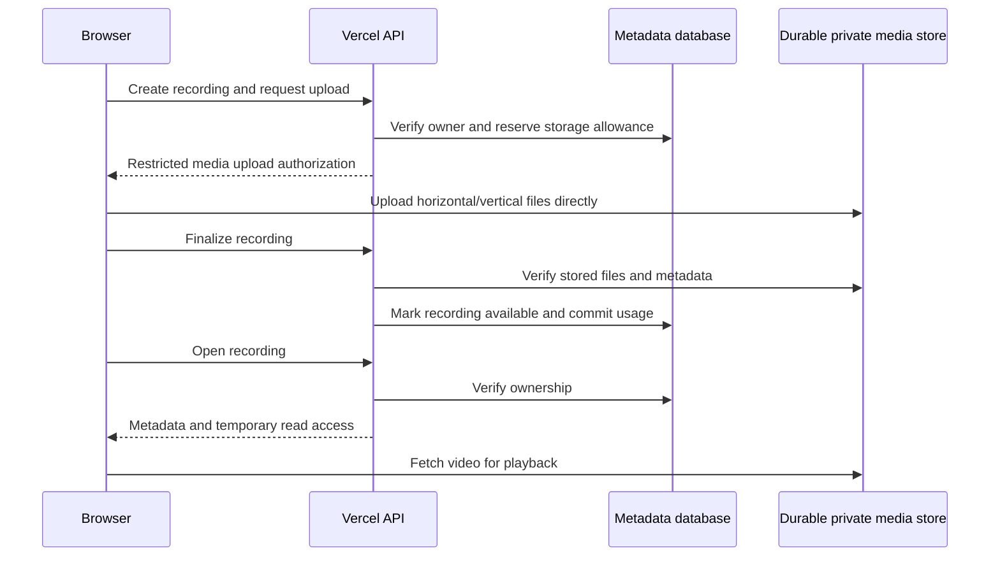

# Repository, deployment and recording storage direction

Decision for the first release: keep the application and its authenticated API in this repository and deploy them as one Vercel project. Add durable recording storage through the same API when that feature is implemented. A separate repository is unnecessary for the current transcription service or for account-owned file storage.

This is an engineering recommendation based on the current code and product scope. Durable cloud recording storage is a proposed next phase; the current release still keeps its project catalogue and original recordings in the browser.

## Why keep one repository and project now?

`src/` contains the recording application, `api/` contains the Vercel entry points, and `server/transcription/` contains the server implementation. `vercel.json` already serves the Vite build and deploys the Node functions together. These parts share authentication, recording IDs, transcript types and release timing. One change can update the browser and API contract in one reviewed commit and one deployment.

The browser can use `/api/...` on the application origin, and production/preview environments can have their own service credentials. Keeping a common origin also avoids introducing another domain and its CORS configuration merely to create the first API.

Repository layout and runtime deployment are separate decisions. If a later worker needs another runtime or independent scaling, it can be deployed independently from this same repository. Vercel supports connecting separate projects to directories within one repository, so an eventual deployment split does not require an immediate source-control split. [Vercel monorepos](https://vercel.com/docs/monorepos)

| Boundary | Initial release | Later change that could justify a split |
| --- | --- | --- |
| Source repository | One repository | Independent product/team ownership, external API consumers and separate release policies |
| Web/API deployment | One Vercel project | Meaningfully different scaling, access controls or release cadence |
| Media storage | Private object storage | A storage policy, region or delivery requirement beyond the chosen provider |
| Expensive processing | Hosted asynchronous transcription | A dedicated render/GPU worker with its own job queue and runtime |

## Current release: local originals and temporary cloud processing

The browser stores project metadata in localStorage and media bytes in OPFS or IndexedDB. Signing in authorizes studio access and the server API; it does not upload the full library or isolate the existing local catalogue by account. Users of the same browser origin currently share that local workspace. See [the storage model](PROJECT_STORAGE.md) and [authentication](AUTHENTICATION.md).

Automatic transcription uploads one saved orientation to a private Blob store. The API binds its upload grant and job state to the verified Clerk account, stores the transient job in Redis, and submits an asynchronous provider job. Those uploads are temporary processing inputs. Completion, cancellation and scheduled cleanup request their deletion; the implementation's retention and failure limits are in [the deployment guide](VERCEL_TRANSCRIPTION.md).

Those temporary objects must never become the canonical saved recording. In particular, the existing transcription cleanup must not be pointed at durable originals. The current Redis job TTL is also unsuitable as the sole permanent recording catalogue.

## Next phase: account-owned recording storage

Keep the API in this Vercel project, and introduce two durable components:

1. **A metadata database**, preferably a relational database such as Postgres, for project/recording ownership, upload state, media references, transcript versions and deletion state.
2. **A private media store** for the actual videos, thumbnails and exported derivatives. Start with a separate private Blob store for durable recordings, with its own credential/environment prefix, separate from temporary transcription media. This separates storage lifetime and cleanup authority without creating another application repository.

Private Blob requires authenticated reads and writes. Vercel's client upload flow sends media directly from the browser to object storage after server authorization, which also avoids the 4.5 MB Function request-body limit. Scoped signed URLs can grant temporary access to a particular private object. [Private storage](https://vercel.com/docs/vercel-blob/private-storage), [client uploads](https://vercel.com/docs/vercel-blob/client-upload), [signed URLs](https://vercel.com/docs/vercel-blob/vercel-signed-urls)

Use Redis for quotas, locks and transient job state. Use the metadata database as the authoritative catalogue with a durable owner relationship. A provider job ID, browser take ID, object pathname or unguessable URL alone should not establish ownership.

### Minimum durable records

| Record | Essential fields |
| --- | --- |
| Project | Server ID, owner ID, name, creation/update times |
| Recording | Server ID, project ID, owner ID, optional client take ID for import/idempotency, title, status, duration, creation/update times |
| Media asset | Recording ID, orientation or asset role, private store/path reference, content type, byte size, version/checksum and upload state |
| Transcript | Recording ID, provider/model provenance, source-media version, actual word timing, corrected text/version |
| Processing job | Recording/source version, operation, provider/worker ID, status, retry/deletion information |

The horizontal and vertical outputs are independent compositions of one take. Save both when providing cloud backup of the current product; do not assume the vertical output can be recreated by cropping the horizontal file. One orientation's audio is enough for transcription, and the transcript can be shared by both outputs when their source timelines match.

### Upload, playback and deletion

The following describes proposed storage behavior, not endpoints already shipped:

Upload completion should be idempotent. Verify the server-created upload reservation and the actual stored object before making the recording available. A failed or interrupted upload must not count as a completed backup. Reserve byte allowance before granting uploads, reconcile it against stored sizes, and release abandoned reservations through cleanup. Quotas should cover bytes, file count, request rates and processing usage separately.

Playback should authorize each recording through its metadata owner, then issue a short-lived read URL or use an authenticated delivery endpoint where stronger revocation is needed. A signed URL is a bearer capability until it expires. Verify seeking/range requests, expiration renewal and the application's cross-origin isolation headers against actual deployed videos before claiming supported cloud playback.

Deletion should first mark the recording unavailable in the database, cancel pending work, and schedule idempotent removal of every associated object. Retain deletion state until file removal is confirmed, retry failures, and reconcile storage usage. A short-lived upload reservation, a temporary transcription file and a saved recording need different retention policies. Backups, recoverability and the user-facing deletion promise should be defined before offering paid cloud retention.

When transcription reads a saved cloud recording, refer to its media asset and grant the provider temporary read access. Refactor the cleanup contract so a job distinguishes owned temporary files from durable source references. Deleting a transcription job should remove its temporary processing assets and provider result; deleting the recording should control removal of the source videos.

## Release sequence

1. Publish this repository as one Vercel project and verify its URL, authentication, assets and API behavior. Optional transcription can remain unavailable until its provider/storage credentials are configured.
2. Add durable metadata and the separate private recording store. Deliver explicit save/upload progress, cross-device library access and cloud playback; keep local files until the server confirms success.
3. Import selected local takes into the signed-in account through an explicit upload action. Existing browser-local IDs do not prove cloud ownership. Decide how local-only and cloud-backed entries appear and how duplicate imports are handled.
4. Add rendered media edits and a processing worker only when that workflow is ready. Keep source assets immutable and associate derived exports with an edit/source version.

Before advertising cloud recording storage, verify a recording can be reopened from another browser using the same account, another account cannot list or read it, interrupted uploads recover, byte usage reconciles, and deletion removes access and eventually cleans all referenced files. Deployment alone does not provide those storage semantics.

## When to extract a service

Extract a render/GPU worker when measurements show that its runtime, execution time or resource requirements deserve separate operation. Give it a queue, explicit source/output references and service authentication; keep public user authorization in the application API. Prefer a separate deployment within the same repository first. Create a separate repository when ownership, consumers and release policies have actually diverged enough to justify maintaining an independently versioned API and shared contracts.
