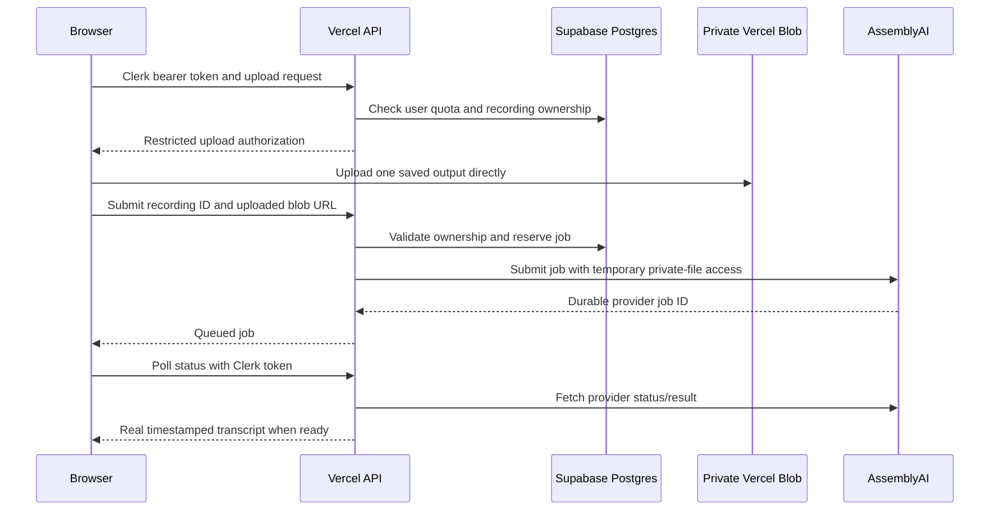

# Deploying automatic transcription on Vercel

The application uses Vercel Node Functions as an authenticated API and AssemblyAI Universal-2 for hosted inference. Vercel does not load a speech model into each invocation. Temporary recordings upload directly to a **private** Vercel Blob store; Supabase Postgres stores account ownership, atomic shared rate limits and job state under forced row-level security. Redis is not required for transcription.

The review page automatically generates a missing transcript once the authenticated API reports that it is configured. It first restores existing text and cloud transcript snapshots, then resumes an existing job or submits one orientation. There is no subtitle-upload UI or provider confirmation dialog. A failed or cancelled attempt remains stopped until explicit retry. Per-account attempt markers prevent repeated paid submissions, and failure to persist those markers blocks automatic submission.

Provider mocks verify workflow behavior rather than live accuracy or billing. A separate real-provider check transcribed 14 seconds of generated Portuguese speech into 29 timestamped words and verified private Blob access and cleanup. That check did not exercise the deployed application with Supabase.

`npm run dev` serves the Vite frontend. To run the Node API locally as well, link the Vercel project, pull its development environment, and use `npx vercel dev`. Use the matching local origin in `APP_ORIGINS`. Run `npm run test:transcription` for focused server/client checks and `npx playwright test tests/cloud-transcription.spec.ts tests/recording-detail.spec.ts` against the Vite server for deterministic browser flows.

## Deployment setup

1. Import this repository into Vercel using the Vite preset. The included `vercel.json` builds with `npm run build`, serves `dist/`, and deploys `api/` as Node Functions. Use Node.js 24, matching local validation.
2. Configure the existing Clerk production instance for the deployed application domain. Use the matching frontend publishable key and server verification credential. Do not create a separate Clerk application just for transcription.
3. Add a Vercel Blob store to this Vercel project and choose **Private** access when creating it. Connect it to every deployment environment that will run transcription. The simple configuration uses its server-side `BLOB_READ_WRITE_TOKEN`.
4. Connect a dedicated Supabase Postgres project through Vercel. Apply the storage migrations with an administrative connection, then configure `DATABASE_URL` for the restricted `grava_app` login and `GRAVA_MAINTENANCE_URL` for cleanup. Runtime rejects owner/admin credentials. Use separate preview resources. See [database roles and provisioning](CLOUD_STORAGE.md).
5. Create an AssemblyAI account/API key. Only the backend receives it. Enable billing and provider spend controls appropriate for the intended usage before making transcription available to customers.
6. Set the variables below for the target environment, generate a long random `CRON_SECRET`, and redeploy. Environment changes do not update an existing Vite bundle automatically.

### Environment variables

| Variable | Purpose |
| --- | --- |
| `VITE_CLERK_PUBLISHABLE_KEY` | Public browser key for the selected Clerk instance; required at build time. |
| `CLERK_SECRET_KEY` **or** `CLERK_JWT_KEY` | Server-side Clerk session verification. The JWT-key option is Clerk's public verification key; the secret-key option must stay server-side. |
| `CLERK_PUBLISHABLE_KEY` | Optional server-only spelling of the matching publishable key; the backend can also read `VITE_CLERK_PUBLISHABLE_KEY`. |
| `APP_ORIGINS` | Required comma-separated exact application origins, for example `https://grava.example.com,https://grava-simples.vercel.app`. Use scheme and host, without paths or trailing slashes. Explicitly configure approved preview origins; do not allow every `*.vercel.app` origin. |
| `ASSEMBLYAI_API_KEY` | Hosted transcription credential, kept on the server. |
| `ASSEMBLYAI_SPEECH_MODEL` | Optional server-only model override: `universal-2` (default) or `universal-3-5-pro`. |
| `BLOB_READ_WRITE_TOKEN` | Credential for the connected **private** Blob store. |
| `DATABASE_URL` | Supabase transaction-pooler URL for the restricted `grava_app` login. |
| `GRAVA_MAINTENANCE_URL` | Separate restricted login that can execute bounded cleanup functions. |
| `CRON_SECRET` | Authenticates scheduled cleanup requests. Vercel sends it as a bearer token to the configured cron route. |

Except for the deliberately public Clerk publishable key, never prefix service credentials with `VITE_`. Vite exposes variables with that prefix to browser code. Keep real values out of `.env.example`, Git, screenshots and source archives.

## How requests flow

Only one orientation needs transcription because the two saved videos contain the same session audio. Uploading media directly to Blob avoids Vercel's 4.5 MB Function request-body limit. API requests exchange small authorization and job documents rather than relaying whole recordings. The server permits only media references belonging to the authenticated upload flow, not arbitrary external URLs.

The provider holds the long-running job. Submit and status calls finish promptly rather than keeping a Lambda-style invocation open until speech recognition completes. The 60-second Function setting is a request budget, not a maximum permitted recording duration.

### Endpoint outline

| Endpoint | Role |
| --- | --- |
| `POST /api/transcription-upload` | Vercel Blob SDK upload-authorization protocol, guarded by Clerk and shared quota. |
| `POST /api/transcriptions` | JSON `{ recordingId, blobUrl }`; validates ownership and submits or reuses the recording's job. |
| `GET /api/transcriptions?recordingId=…` | Returns that signed-in user's job status or completed transcript. |
| `DELETE /api/transcriptions?recordingId=…` | Cancels/removes that user's transcription job and its temporary resources. |
| `GET /api/transcription-cleanup` | Scheduled transcription and recording-orphan cleanup, authenticated with `CRON_SECRET` rather than a customer session. |

Job knowledge is not authorization: status and cancellation check account ownership independently. Keys and provider responses must not be logged with session tokens, signed media URLs, or recording content.

User endpoints require an explicit Clerk bearer token; a session cookie alone does not authorize them. Status responses include `configured`, `status`, `jobId`, `error`, `noSpeech`, optional `transcript`, and `maxUploadBytes`. Submission returns HTTP 202 with a queued job; cancellation returns an idle state. Word times are normalized from the provider's actual millisecond values to seconds.

## Limits and retention

The initial backend policy allows one media object up to **512 MB** and processes at most **two hours** of source audio. The duration cap is passed to the provider; browser-supplied duration is not trusted as a billing boundary. Default per-user quotas are six upload grants per day, six submissions per day and 60 status requests per minute, with a per-recording lock/idempotency check. A fresh upload authorization also consumes quota, so clients should reuse an existing pending job instead of repeatedly requesting new uploads.

Temporary Blob media and the provider transcript are deleted when processing completes, errors, or is cancelled. Normalized results remain available in Postgres until job cleanup. The library can separately persist a versioned transcript snapshot with its durable recording backup. AssemblyAI's own raw media handling/retention is governed by its service policy; deleting the transcript is not a promise that every provider backup disappears immediately.

Jobs expire after 24 hours. The configured cleanup job runs daily at **03:00 UTC**, handling at most 50 eligible jobs per invocation. An abandoned upload can therefore remain for approximately 48 hours before its next eligible sweep, and longer if a cleanup attempt fails or cannot finish its bounded batch. Expired job rows remain until cleanup succeeds, allowing failed deletions to retry without relying on a database TTL. The schedule is not an unconditional deletion-time guarantee: keep cron enabled, set its secret, and monitor failures and backlog. Increase cleanup frequency/capacity before a sustained orphan rate approaches that daily batch limit.

Transcription uploads are temporary processing inputs. Durable recording backup uses a separate private Blob store and account-owned catalogue, with optional local caching; see [cloud recording storage](CLOUD_STORAGE.md). Cancelling a transcription does not delete a durable original. Authored scenes and their assets remain local.

## Vercel routing and headers

The configuration retains `Cross-Origin-Opener-Policy: same-origin` and `Cross-Origin-Embedder-Policy: require-corp` for local FFmpeg export. HTML uses `no-cache`; API responses use `no-store`. Real files and Functions resolve before SPA rewrites. Known application/authentication paths fall back to `index.html`; missing API endpoints and missing assets retain a 404 instead of receiving HTML.

Clerk's production domains and assets must work under those final headers. Test redirect-based login and project/recording direct links on the deployed domain. Private Blob uploads and signed provider reads also need deployment-level verification; a static Vite preview alone does not execute the API.

## Why use hosted inference first?

Vercel now supports optional 5 GB Function bundles and extended Pro/Enterprise execution up to 30 minutes; the older universal 250 MB argument is no longer accurate. However, standard CPU/memory allocations and model warmup still make hosted inference the easier first deployment. This implementation needs no self-managed GPU worker or browser model download. [Current Function limits](https://vercel.com/docs/functions/limitations), [large Function beta](https://vercel.com/changelog/vercel-functions-can-now-be-up-to-5-gb-in-package-size), [extended duration](https://vercel.com/changelog/vercel-functions-can-now-run-up-to-30-minutes)

Universal-2 supports 99 languages including Portuguese and produces actual word timestamps through the asynchronous transcript API. Keep Portuguese/English proper names, code switching, silence and noisy recordings in the live acceptance set. Model choice should follow those recordings rather than a generic accuracy claim. [AssemblyAI model selection](https://www.assemblyai.com/docs/pre-recorded-audio/select-the-speech-model), [supported languages](https://www.assemblyai.com/docs/pre-recorded-audio/supported-languages), [transcript API](https://www.assemblyai.com/docs/pre-recorded-audio/api-reference/transcripts/submit)

For alternative providers and the current platform changes, see [the research addendum](VERCEL_TRANSCRIPTION_RESEARCH.md). The provider key, restricted Postgres connections, private temporary Blob store and application-origin configuration must be supplied before this feature can run live. Provisioned credentials or passing mocks do not replace a real deployed transcription test.

At the 2026-10-31 deployment check, both private Blob stores and the AssemblyAI credential were present in Vercel Production, but no database connection URL had synchronized. Automatic application transcription therefore remained unavailable pending the Supabase connection and production migrations. Enabling the automatic UI does not bypass that backend configuration gate.
